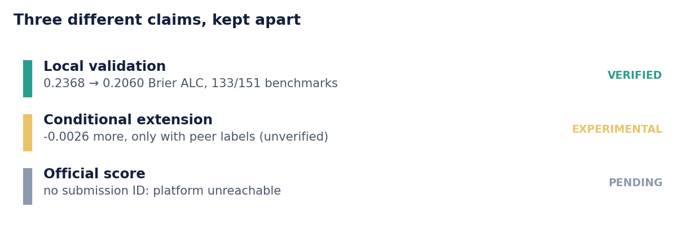
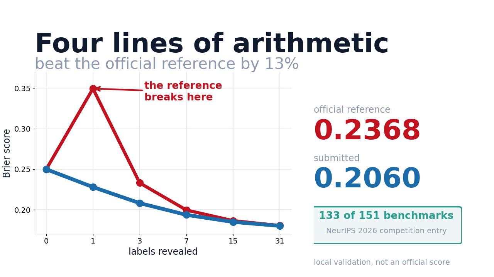
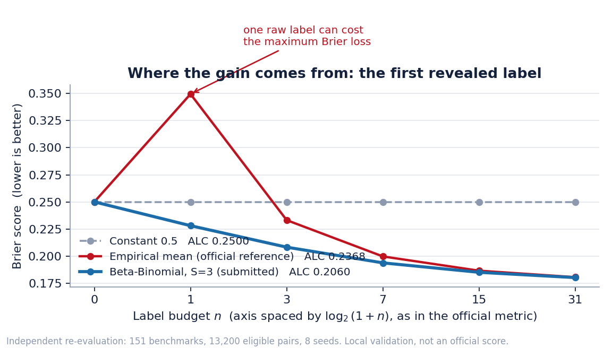
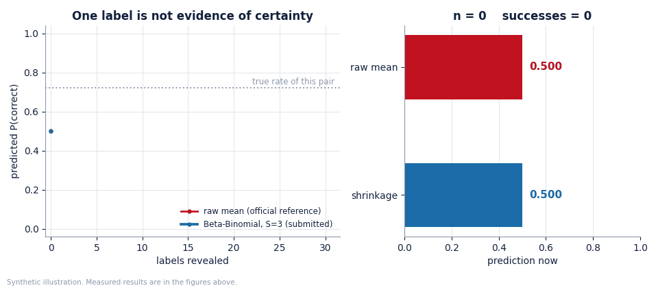
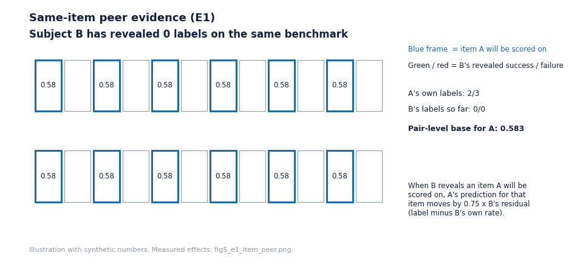
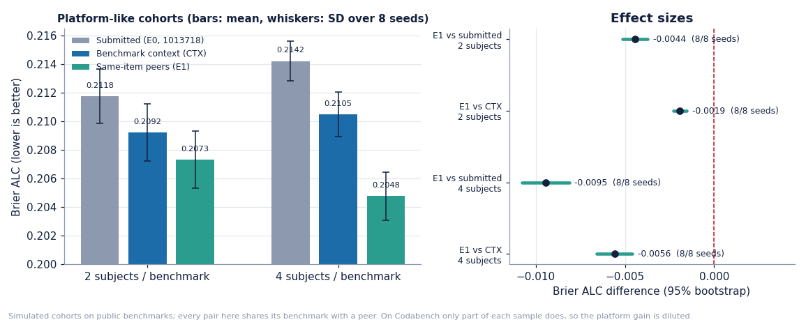
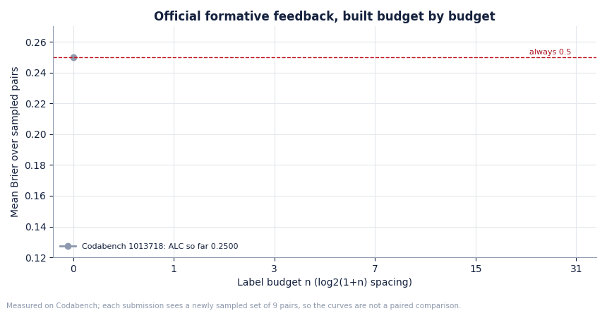
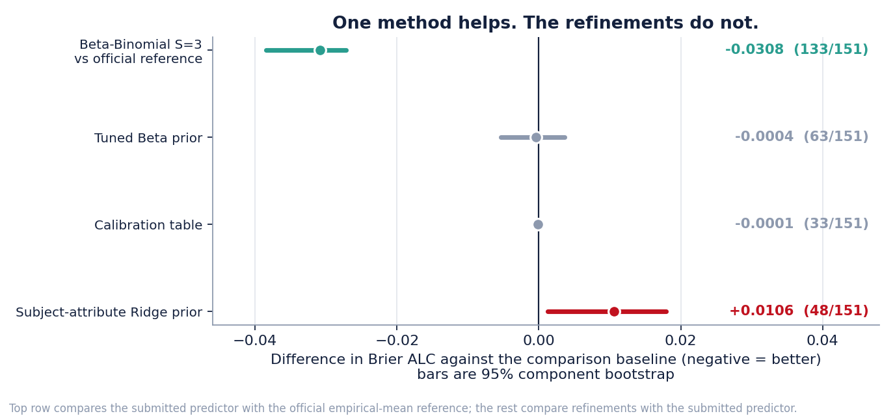
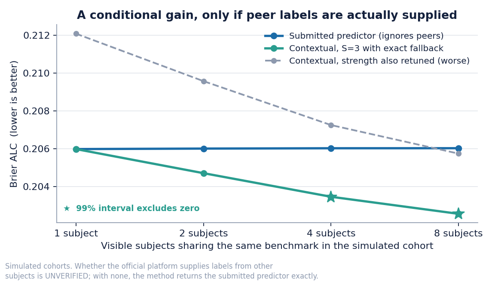
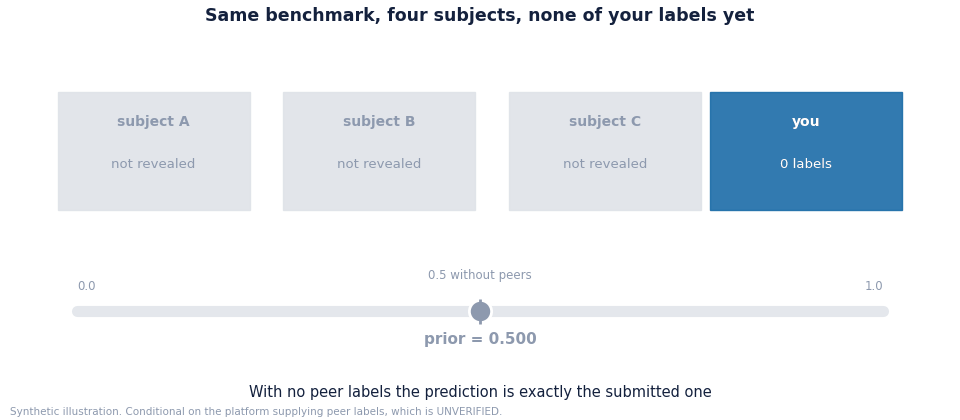

# Predicting whether an AI system will get an item right

**Predictive AI Evaluation Competition — NeurIPS 2026 (Stanford AIMS)**

[](LICENSE)
[](requirements.txt)
[](https://github.com/Agnuxo1/AIMS-PAIEC-2026/actions/workflows/ci.yml)
[](report/informe_v4.pdf)
[](#official-codabench-results)

Francisco Angulo de Lafuente · Independent researcher, Madrid, Spain

---

Given an AI system and a benchmark item it has never been scored on, predict the
probability it answers correctly. You may be shown a handful of labels for that
system first — 0, 1, 3, 7, 15 or 31 — and you are scored by **Brier ALC**, the
area under the resulting learning curve, computed per subject–benchmark pair and
averaged with every pair weighted equally. The test items come from benchmarks
that are **entirely absent from training**, so nothing benchmark-specific can be
transferred.

Our first submission is four lines of arithmetic; our selected submission adds
one idea on top — **a peer's label on the very item being predicted** — and is
still about forty lines of pure Python with no training, files or network. Most
of this repository is the evidence for why it is that small.

| At a glance | |
|---|---|
| Selected Codabench submission | **1015136** — `submission_item_peer.zip` (E1) |
| Selected submission, formative score | Brier ALC **0.185082** on 8 sampled pairs (ECE 0.123419) |
| Earlier Codabench submission | 1013718 — `submission_original.zip`, formative Brier ALC **0.208365** on 9 pairs |
| Local validation, submitted rule vs official reference | 0.236814 → **0.205984** (13,200 pairs, 8 seeds) |
| E1 vs the submitted rule, cohorts of 2 subjects | **−0.004437** [−0.005139, −0.003741], 8/8 seeds |
| Technical report | [`report/informe_v4.pdf`](report/informe_v4.pdf), NeurIPS template, 7 pages |



<p align="center">
  <a href="https://youtu.be/dBfUTN5afcQ">
    
  </a>
  <br>
  <b><a href="https://youtu.be/dBfUTN5afcQ">Watch the 4-minute explanation</a></b>
  &nbsp;·&nbsp; English narration, no subtitle track
</p>

**28 October update.** Codabench is reachable again. Both the original rule
(1013718) and the new same-item predictor (1015136) ran on the platform; the
[v4 report](report/informe_v4.pdf) adds experiment E1 and the official feedback.
The 25 October [five-page report](report/informe_v3.pdf) and every earlier
archive remain byte-for-byte unchanged.
[Earlier audit evidence](docs/evidence/closure_audit_20261025.json).

## The result

Under an independent re-evaluation over **151 benchmarks, 13,200 eligible pairs,
105,600 scenarios and 8 seeds**, the official empirical-mean reference scores
**0.236814** and our predictor **0.205984** — a difference of **−0.030830**,
95% component bootstrap **[−0.038426, −0.027214]**, improving **133 of 151**
benchmarks.



The whole gap opens at the first revealed label. The official reference returns
the raw mean of the labels it has seen, so with one label it predicts 0 or 1 and
a single wrong guess costs the maximum Brier loss. Its B₁ of 0.3496 is worse than
ignoring the labels entirely.

<p align="center">
  
</p>

> The reference is **deliberately simple**. Beating it is not evidence of being
> competitive with other entrants, and we do not claim it is.

## The method

$$\hat{p} \;=\; \frac{\alpha + k}{\alpha + \beta + n}, \qquad \alpha = P_0 S, \quad \beta = (1 - P_0) S, \qquad P_0 = 0.5,\; S = 3$$

with `k` successes among the `n` labels revealed for that subject and that
anonymous `benchmark_id`. `S = 3` is the argmin of a disjoint development split,
inside a region flat over `S ∈ [3, 5]`. The predictor keeps no state, fits
nothing at run time, needs no network, no files and no payload.

```python
import sys; sys.path.insert(0, "submissions/original")
from model import predict        # the exact file inside submission_original.zip

subject = {"normalized_name": "Example LM", "provider": "Example",
           "release_date": "2025-01-01", "access_date": "", "harness": "",
           "harness_version": "", "reasoning_effort": "", "subject_features_extra": ""}
item    = {"item_content": "What is 17 x 24?", "item_features": "",
           "interactors": "", "benchmark_id": "bench_a"}

predict([subject, item], [])                       # 0.5     no evidence
predict([subject, item], [[[subject, item], 1]])   # 0.625    one success
predict([subject, item], [[[subject, item], 0]])   # 0.375    one failure
```

## Same-item peer evidence (E1) — the selected submission

The official ingestion
([`tools/streaming_ingestion.py`](https://github.com/aims-foundations/paiec_baseline),
commit `cc88a95`) hands **one global `labeled` list** to every prediction, and
the rules draw the 50/50 acquisition/evaluation split **per subject–benchmark
pair**. So another subject may already have revealed the item you are about to
predict. Its label, measured against that subject's own rate, says how hard the
item is.

$$\hat{p} = \mathrm{clip}\Big(\frac{k+3m}{n+3} + \lambda\,\frac{\sum_j \big(y_j - \hat r_j^{(-i)}\big)}{c+\\#\lbrace j\rbrace}\Big),\qquad \lambda = 0.75,\; c = 1$$

where `m` is the benchmark-context prior and `r_j^(-i)` is peer `j`'s
leave-one-out rate. With no same-item label the shift is zero; with no peer at
all the output is **exactly** the submitted rule of 1013718.

<p align="center">
  
</p>

The hypothesis, grid and acceptance rule were
[pre-registered](experiments/E1/PREREG_E1.md) before the run. A platform-like
simulator ([`experiments/E1/run_e1.py`](experiments/E1/run_e1.py)) builds cohorts
of subjects sharing a benchmark, 88–152 items per pair as observed on Codabench,
independent 50/50 splits and random acquisition, over 8 seeds; λ and c are chosen
on four content-component folds and scored on the fifth. The same configuration
won in all five folds.



| Held-out comparison | 2 subjects / benchmark | 4 subjects / benchmark |
|---|---|---|
| E1 vs submitted rule | **−0.004437** [−0.005139, −0.003741] · 8/8 seeds · 118/134 | **−0.009450** [−0.010788, −0.008131] · 8/8 · 97/105 |
| E1 vs benchmark context only | −0.001930 [−0.002305, −0.001546] · 8/8 · 116/134 | −0.005583 [−0.006602, −0.004598] · 8/8 · 92/105 |
| Residuals without the context prior vs context | +0.000459 [−0.000390, +0.001357] · 0/8 — **rejected** | −0.001998 [−0.003542, −0.000355] |

The shipped [`model.py`](submissions/item_peer/model.py) reproduces the
simulator **exactly** (216 pair curves, max error 0) and equals the original
rule when only the target's own labels exist (2,220 checks):
[`experiments/E1/parity_e1.py`](experiments/E1/parity_e1.py). Every simulated
pair shares its benchmark with a peer; on Codabench only part of a sample does
(4 of 9 pairs in 1013718), so expect roughly half the effect there. Full log:
[`experiments/LOG.md`](experiments/LOG.md) · [`experiments/experiments.csv`](experiments/experiments.csv).

## Official Codabench results

| ID | Archive | Sampled pairs | Brier ALC (formative) | ECE |
|---|---|---|---|---|
| 1013718 | `submission_original.zip` | 9 | 0.208365 | 0.136929 |
| **1015136** | `submission_item_peer.zip` (selected) | 8 | 0.185082 | 0.123419 |

<p align="center">
  
</p>

Each formative evaluation draws a **new** sample of only nine subject–benchmark
pairs, so the across-pair standard error is about 0.022: these numbers prove the
archives run on the platform, not which method is better (the two samples share
no subject–benchmark pair). The final ranking uses
a common hidden subset for all teams. Per-pair feedback:
[`docs/evidence/`](docs/evidence/).

## What did not work

Seven extensions produced no detectable improvement. We report them because they
bound where the remaining signal is *not*.



| Attempt | Outcome |
|---|---|
| Tuned Beta prior | −0.000449, CI95 [−0.005350, +0.003663], 63/151 — inconclusive |
| Calibration table | −0.000107, CI95 [−0.000522, +0.000105], 33/151 — inconclusive |
| Subject-attribute Ridge prior | **+0.010565**, CI95 [+0.001218, +0.017943] — worse |
| Response-weighted global prior | Worse. The metric averages per pair, not per response |
| Per-budget shrinkage tuning | Selects the same `S` at every budget with labels |
| Item-text features for the cold-start budget | No detectable effect on ALC |
| Per-item deviation from the pair mean | Strictly worse at every weight, with hand-built features and with hashed sparse text, even when started from the true pair rate |

The last one matters most: an oracle restricted to one value per pair leaves a
large gap that is almost entirely **variation between items inside a pair**, and
nothing we tried reached it. That gap is still available to whoever can.

## A conditional extension, reported separately

The scoring interface can supply labels for *other* subjects on the same
benchmark. If it does, a variant that mixes peer evidence into the prior and
**returns the submitted predictor exactly when no peer labels exist** gains a
further **−0.002562** in a simulated four-subject cohort — a relative 1.24% —
with a 99% interval of **[−0.006257, −0.000551]** adjusted for five candidates,
favourable across all eight seeds.



<p align="center">
  
</p>

> **Experimental.** Whether the official platform actually supplies peer labels
> is **unverified**. The figure estimates a *nested selection procedure*, not an
> untouched test of the final parameter. Without peer labels the two predictors
> are numerically identical, so the variant cannot be worse than the submission
> in that case. It is shipped as a separate archive and is not the default.

## Independent audit

An independent re-derivation reproduced the original 496 headline pairs from the
Parquet files without executing the original evaluator — maximum per-pair error
**1.11 × 10⁻¹⁶** — and then found real defects, all of which are documented in
[`AUDITORIA_COMPLETA.md`](AUDITORIA_COMPLETA.md) and corrected in the protocol
used here:

- The leave-one-benchmark-out fit for the *rich* priors excluded only the target
  benchmark, so other headline benchmarks were visible during development. The
  fixed Beta prior learns nothing from those aggregates and does not inherit the
  defect, but the refinements did; they are now selected under nested folds.
- Some eligibility filters counted 80 **responses** instead of 80 **distinct
  items**. 90 public pairs sit in that gap.
- Capping six subjects and 150 evaluation items per benchmark changed the
  population. The new evaluation uses all 13,200 eligible pairs.
- An empirical oracle was described as a noise floor. A retrospective fit to
  observed responses does not establish irreducible noise on new responses.

Three audit findings on the public data are also reported: **1,980 of 2,898,123**
distinct content hashes appear in more than one benchmark; no leakage was found
in the fields the predictor receives, in a keyword screen; and a fifth of
repeated subject–item observations contain both a success and a failure.

## Quickstart

```bash
git clone https://github.com/Agnuxo1/AIMS-PAIEC-2026.git
cd AIMS-PAIEC-2026
python -m pip install -r requirements.txt

# 1. Fast checks that need no data download (this is what CI runs)
python audit/test_data_and_inference.py

# 2. Regenerate every figure and animation from the committed results
python build/make_figures.py --repo . --out docs/figures
python build/make_gifs.py --out docs/figures
python build/make_e1_figures.py --repo . --out docs/figures
```

Reproducing the scores needs the public dataset. The downloader is pinned to
revision `54074453da7b9911be0f48e4c560be547bc84d21` with per-file SHA-256, and
fetches **5,354,371,887 bytes** across **890 files**:

```bash
python audit/download_pinned.py --data /path/with/space   # verifies every hash
# (--data is required; the script does not read AIMS_DATA on its own)
python audit/build_independent.py        # 151 benchmarks, 13,200 pairs
python audit/evaluate_independent.py     # Table above
python audit/evaluate_context.py         # conditional extension

# E1: needs the per-(subject,item) cache written by build_independent.py (audit/raw_cache)
cp -r audit/raw_cache experiments/E1/raw_cache && cp results/pairs.parquet experiments/E1/
python experiments/E1/run_e1.py 2        # cohorts of 2 subjects (about one minute on CPU)
python experiments/E1/run_e1.py 4        # cohorts of 4 subjects
python experiments/E1/parity_e1.py .     # shipped model.py == simulator, exact fallback
```

Accepting the dataset conditions on Hugging Face is required. Raw data, caches,
environments and credentials are deliberately **not** in this repository.

## Layout

```
submissions/   submission_item_peer.zip (selected, E1), submission_original.zip (1013718) and the contextual archive
audit/         independent protocol, pinned downloader, evaluators, tests
results/       every score, candidate, manifest and uncertainty estimate, including the unfavourable ones
report/        informe_v4.pdf (current), earlier v2/v3, LaTeX sources and the official style file
experiments/   E1 pre-registration, simulator, parity test, scores, LOG.md and experiments.csv
legacy_original/  the first delivery, kept intact for provenance
build/         figure and animation generators
docs/figures/  figures and GIFs, all regenerable from results/
docs/video/    narration script, render scripts, thumbnail and timings
```

## Limitations

Errata, known deviations and what was not reproduced: see [`ERRATA.md`](ERRATA.md).


Local validation is not an official score. We report Brier ALC on public
benchmarks held out from each other, which is a proxy for the private pool. The
E1 simulator assumes how the platform samples subjects and items; the share of
pairs that meet a peer on Codabench dilutes its effect. The
hyperparameter grids, the pre-registration locks and the instrumentation
corrections — including the first failed attempts — are committed alongside the
results rather than cleaned away.

## Competition status

| Item | State |
|---|---|
| Submission archives | Three, all pass the official `check_submission_zip.py` and CI |
| Codabench | Registered; **1013718** finished (0.208365); **1015136** (E1) finished (0.185082) and selected for final evaluation |
| Technical report | v4, 7 pages, official NeurIPS template, compiled without errors |
| OpenReview | Submission form verified; upload of v4 with ID 1015136 pending the author's login |
| Earlier e-mail deposit | 24–25 Oct 2026 while Codabench was down; superseded by the platform submissions |

Formative Codabench scores are reported as such; no ranking, acceptance or final score is claimed.
See [`CIERRE_AIMS.md`](CIERRE_AIMS.md) for the exact state of each deliverable.

## Citation

```bibtex
@misc{angulo2026paiec,
  title  = {Shrinkage under benchmark holdout: a reproducible study and
            public-data audit for predictive AI evaluation},
  author = {Angulo de Lafuente, Francisco},
  year   = {2026},
  note   = {Entry to the Predictive AI Evaluation Competition at NeurIPS 2026},
  url    = {https://github.com/Agnuxo1/AIMS-PAIEC-2026}
}
```

## References

- Competition rules and metric definition — <https://aims.stanford.edu/competition>
- Public training release `aims-foundations/measurement-db` — <https://huggingface.co/datasets/aims-foundations/measurement-db>
- Official baseline predictors `aims-foundations/paiec_baseline` — <https://github.com/aims-foundations/paiec_baseline>
- Brier, G. W. (1950). *Verification of forecasts expressed in terms of probability.* Monthly Weather Review 78(1), 1–3.

Third-party components and their licences are listed in
[`THIRD_PARTY.md`](THIRD_PARTY.md). The benchmarks keep their upstream licences;
no third-party PDF is redistributed here.

## Licence

MIT — see [`LICENSE`](LICENSE).

Developed with substantial assistance from large language models, for code, for
prose and as adversarial critics of the analysis. Three rounds of independent
re-derivation were run before submission and each found errors that were
corrected.
