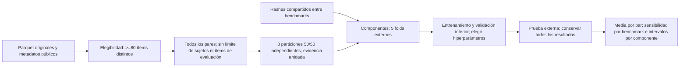

# Protocolo independiente AIMS — 24-10-2026

Registrado antes de calcular nuevos resultados. El código anterior y sus resultados se tratan como objetos de auditoría; no se importan sus módulos ni sus cachés pickle para construir la nueva evaluación.

## Flujo y controles

1. Inventariar los 281 directorios locales desde sus propios `benchmarks.parquet`; contrastar con el catálogo derivado. Solo `release=public`. Escanear soporte observado y valores ausentes. Incluir soporte no vacío contenido en {0,1}, incluidos benchmarks constantes; listar todos los rechazos. No reinterpretar escalas ni invertir etiquetas por su descripción.
2. Leer respuestas originales por bloques y agrupar por sujeto e ítem. Un par elegible tiene al menos 80 ítems con respuesta binaria observada. La media oficial pondera cada par por igual. También se informa media por benchmark, sin sustituir la métrica principal.
3. Semillas fijas: 17,29,43,71,101,137,181,233. Cada semilla reconstruye una partición 50/50 con ítems canónicamente ordenados. Adquisición aleatoria sin reemplazo de ítems, una respuesta aleatoria entre las registradas por ítem; presupuestos anidados 0,1,3,7,15,31. Puntuar TODAS las respuestas de los ítems de evaluación. Comprobar por separado la sensibilidad a usar siempre la primera repetición.
4. Obtener componentes conexos de benchmarks que compartan `content_hash` no vacío; nunca separar un componente entre entrenamiento, validación y prueba. Cinco folds externos asignados por SHA-256 estable al grupo, y validación interior de grupos determinista dentro del entrenamiento externo. Registrar manifiesto antes de abrir la tabla de puntuaciones.
5. Baselines: constante 0,5; media empírica oficial; entrega original Beta(1,5;1,5), con fórmula independiente y pruebas de conformidad separadas del código original.
6. Mejora A: calibración de la probabilidad según presupuesto y número de éxitos (`n,k`), ajustada por mínimo Brier con regularización hacia el baseline. Rejilla de mezcla con el baseline: 0,0,25,0,5,1. La tabla se aprende solo en entrenamiento; la mezcla se elige solo en validación interior. Probar además Beta-Binomial con media y fuerza aprendidas en el conjunto interior: media 0,4/0,5/0,6 y fuerza 0,5/1/2/3/5/8/16.
7. Mejora B: prior condicionado a atributos del sujeto, con regresión ridge regularizada sobre nombres, proveedor, harness y esfuerzo, disponible en la interfaz oficial. Solo datos públicos; ningún benchmark_id como atributo predictor. Regularización 1/10/100 y mezcla de prior 0/0,25/0,5/1. Fuerza 1/3/8. Aprendizaje y elección solo interiores. Resultados externos de todas las familias, aunque no mejoren.
8. Inferencia principal: promediar primero las 8 semillas por par, bootstrap de 10.000 remuestreos de COMPONENTES completos, recalculando cociente suma de diferencias/número de pares. Media por benchmark y eliminación del componente de mayor peso como sensibilidades. Tres familias mejoradas implican comparaciones múltiples: intervalos al 98,33 % además de 95 %; una mejora no se promueve por una sola semilla ni solo por la puntuación puntual.
9. Los benchmarks públicos ya fueron inspeccionados durante el sprint anterior: esta evaluación es una revalidación local anidada, no una prueba prospectiva inédita ni la puntuación privada oficial. No afirmar causalidad ni intención de ocultación a partir de errores. Una auditoría no puede demostrar ausencia exhaustiva de archivos borrados o experimentos no guardados.
10. Conservar fuentes/resultados originales, hashes y todos los candidatos. Trabajo CPU limitado a cuatro hilos y una tarea pesada a la vez. Si hace falta GPU, servidor-ia y su cola; no interrumpir trabajos ajenos. Ninguna API de pago, envío externo, publicación o rotación de claves en este trabajo.

La ampliación a texto/embeddings, si resulta justificada por hallazgos verificables, se registrará como experimento exploratorio adicional antes de ejecutarlo; no se presentará como contraste confirmatorio preespecificado.
